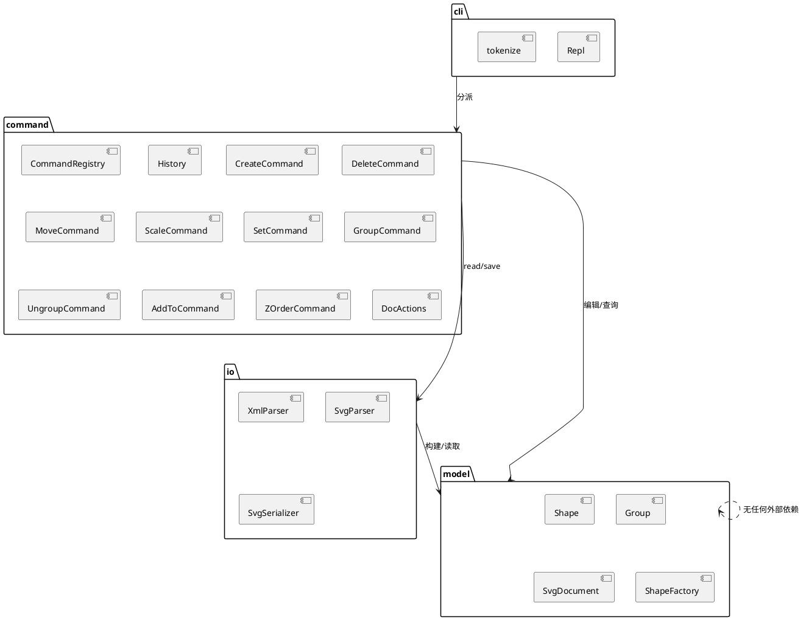

# SVG 编辑器（CLI）— 架构文档

软件设计 PJ1 Phase 1。TypeScript + 面向对象实现的命令行 SVG 编辑器，
零运行时第三方依赖（XML 解析器为自实现子集），devDependency 仅 `typescript` + `@types/node`。

运行：`npm install && npm run cli`（tsc 编译到 `dist/` 后启动 REPL）。

## 一、架构方案

### 1. 模块划分

```
src/
├── model/      图形模型层：Shape 抽象基类 + Rect/Circle/Ellipse/Line/TextShape/Group
│               + SvgDocument（画布、id 索引）+ ShapeFactory（类型注册表）
├── command/    命令层：Command/Action 接口、History（undo/redo 栈）、
│               各编辑命令（一类一文件）、actions/（文档类与显示类）、CommandRegistry
├── io/         IO 层：XmlParser（迷你 XML 子集解析器）、SvgParser（读入+补 id）、
│               SvgSerializer（序列化为合法 SVG XML）
└── cli/        入口层：tokenize（双引号参数）、Repl（提示符/注释/错误前缀）、main
```

职责：

- **model**：只关心"图形是什么、能对自己做什么"（move/scale/set/serialize 属性表），
  不知道命令、不知道文件、不知道终端。
- **command**：把用户输入翻译成对 model 的一次原子修改，并记录逆操作所需信息
  （删除前的父与位置、set 的旧值等）。文档类/显示类实现 `Action`（只运行）；
  编辑类实现 `Command`（execute/undo）。
- **io**：SVG XML ⇄ model 的双向转换。读入时缺 id 自动分配并产生警告。
- **cli**：逐行读入、分词、找注册表分派、打印结果/错误。

组件图（PlantUML）：



### 2. 设计模式的选择与落地

- **Command 模式（任务书强制）**：`src/command/Command.ts` 定义
  `Command { execute(); undo() }`，每条编辑命令一个类（`CreateCommand`、`DeleteCommand`、
  `MoveCommand`、`ScaleCommand`、`SetCommand`、`GroupCommand`、`UngroupCommand`、
  `AddToCommand`、`ZOrderCommand`）。构造时完成全部校验（失败不改状态），
  `execute()` 做修改并记录逆操作快照。`History` 持有 undo/redo 双栈：
  新编辑清空 redo 栈；文档类命令执行后 `block()` 清空两栈并拒绝
  undo/redo（`error: undo not allowed after io command`），直到下一条编辑命令解禁。
  回显文案由命令自己产出，undo 的回显（如 `circle#c1 moved back to (100,100)`）
  就是 `undo()` 的返回值。
- **Composite 模式**：`Group`（容器）与叶子图形同继承 `Shape`，
  `move`/`scale`/`set`/`delete`/`front`/`back` 对二者一视同仁——
  命令层从不判断"这是不是一个组"（`move node2` 整体平移就是 `Group.move` 递归）。
  `tree` 的递归渲染也走同一接口。
- **工厂 + 注册表**：`ShapeFactory` 以注册表持有六种内置类型
  （rect/circle/ellipse/line/text/g）的参数 schema 与构造器，
  `create box` 命中未注册类型即报
  `error: unknown shape type: box (is the plugin loaded?)`。
  这为后续插件化阶段（ShapeProvider）留了插槽。
- **按名分派仅两处**：`CommandRegistry.dispatch`（命令名→实现）与
  `ShapeFactory`（类型名→类）。两者都是显式注册表而非散落的 switch，
  按任务书要求在此标注为**待重构点**（插件化阶段应把注册动作移出内核）。

### 3. 依赖方向规则

| 规则 | 理由 |
|---|---|
| `model` 不依赖任何模块 | 模型是纯核心，谁都能用它 |
| `io` → `model` | 读写文件只需要懂模型 |
| `command` → `model` | 命令修改模型 |
| `command` → `io` | read/save 命令需要 IO（单向，io 不知 command） |
| `cli` → `command`（间接到 model/io） | 入口只做分派与打印 |

违反以上方向的 import 即为待处理项。当前代码无违反（见一致性自查）。

### 4. 变化点假设

1. **新增图形类型（最可能，任务书 4.4 已预告 `box`）**：
   留了 `ShapeFactory.register` 插槽，新类型=一个 Shape 子类+一行注册。
   复合图形的 `set` 传播语义（fill→子 rect）暂不支持，届时需在 Shape 上
   增加"属性转发"钩子——目前**故意不留**，避免为未定的插件协议过度设计。
2. **新增命令**：`CommandRegistry.register` 一行接入；undo/redo 自动获得。
3. **输出格式变化**（tree 对齐列宽、回显文案）：文案集中在各 Shape/Command 的
   方法里，改一处即可；tree 对齐算法独立在 `TreeAction.formatRows`。
4. **XML 能力扩展**（实体、CDATA、命名空间）：解析器隔离在 `io/XmlParser`，
   可整体替换为成熟库而不动其余代码。
5. **持久化格式变化**：`SvgSerializer` 单点负责属性顺序与缩进。

## 二、过程记录（与 AI 协作的关键迭代）

本项目主体由 AI（Kimi Code agent）按任务书一次搭出骨架，随后通过
"写验证脚本 → 管道回放 → diff 任务书期望输出"的循环迭代收敛，关键节点：

1. **id 索引失效 bug**：初版 `SvgDocument.register()` 把 `Group.walk()` 的
   generator 遍历了两次（第一次查重、第二次登记），第二次迭代为空，
   导致 `create g flowchart` 之后任何按 id 查找都报 `no such shape`。
   §6.1 会话脚本第一遍全红暴露了它；定位为 generator 二次消费后改为
   先物化为数组。**教训：generator 只能消费一次，这类 bug 编译器查不出，
   只有端到端回放能抓到。**
2. **错误文案偏差**：`create rect … in node9` 初版复用了 `find()` 的
   `no such shape`，与任务书 §4.2 的 `no such container: node9` 不符；
   逐条核对 §4.2 表格后修正（has→no such container / isContainer→not a container）。
3. **ungroup undo 的重复注册**：undo 先把子节点挂回组（已注册 id）、
   再挂回容器时整棵子树重复登记，报 `id already exists`。修正为
   注册时容忍"同一对象已登记"，拒绝"不同对象占用同 id"。
4. **tree 对齐规则的确认**：任务书 §6 主 transcript 与 `other.svg` 树的属性列
   都精确落在同一绝对列（前缀宽+标签宽的最大值 + 2 空格），
   而 §6.1 流程图示例自身列宽不一致（`rect#process` 与 `text#process-label`
   的属性列相差 2 列，属手写误差）。与 AI 核对后采用全局统一列规则：
   **属性列 = max(前缀长+标签长，仅统计有属性的节点) + 2 空格**，
   该规则逐字符复现 §6 主 transcript 与 other.svg 两处示例；
   §6.1 的差异（1–3 个空格）记录在此，`tests/expected_flowchart.txt`
   按本规则生成。
5. **任务书未定义的回显**（ungroup/front/back/scale/canvas 修改等）由 AI 给出
   合理文案并在本文档备案，例如 `g#inner ungrouped, 1 children promoted`、
   `canvas resized to 1024x768`、`circle#c1 scaled by 2` / undo 时
   `circle#c1 scale restored`。

## 三、一致性自查

1. **模块划分**：实际目录与 §一.1 完全一致（model/command/io/cli 四层 +
   command/actions 子目录），无修订。
2. **依赖方向**：抽样核对 import——
   - `src/model/*` 只 import 同层文件 ✔
   - `src/io/*` 只 import `../model/*` ✔
   - `src/command/*` import `../model/*` 与 `../io/*`（仅 ReadAction/SaveAction） ✔
   - `src/cli/*` import `../command/*` 与 `../model/Shape`（错误类型） ✔
   无反向依赖。按名分派只在 `CommandRegistry` 与 `ShapeFactory` 两处 ✔。

## 四、质量保证手段

- **端到端回放测试**（`tests/run.sh`，`bash tests/run.sh`）：
  1. `tests/session_main.txt`：任务书 §6 完整 transcript（含 `#` 注释行），
     输出与 `tests/expected_main.txt` **逐字节 diff**（含 tree 对齐、`saved to
     demo.svg (5 elements)`、undo 回显、`error: undo not allowed after io command`）；
  2. `tests/session_flowchart.txt`：§6.1 流程图会话（含中文 text、`in` 子句、
     容器 move/undo）；
  3. `tests/session_errors.txt`：§4.2 错误矩阵逐条覆盖（id 重复/不存在、
     容器类错误、未知类型 box/hexagon、scale 非正数、文件不可读/不可写、
     未 init、unknown attribute、undo/redo 边界）。
     注：§4.2 的 `cannot ungroup composite shape` 属于 box 插件语义，本阶段
     box 未实现，无从触发，故不在矩阵中；
  4. round-trip：`read examples/other.svg → save → 再 read → tree`，
     与直接 read 的 tree 完全一致，且第二次 read 不再产生缺 id 警告
     （验证序列化写回了分配出的 id）。
- **类型安全**：`tsc --noEmit` strict 模式零错误（`npm run build`）。
- **手动冒烟**：show/canvas/front/back/scale/help/交互提示符逐一试过。
- **生成物可用性**：`save` 产物（如 `tests/.tmp/demo.svg`）为合法 SVG XML，
  可直接在浏览器打开。
